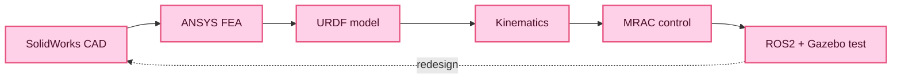
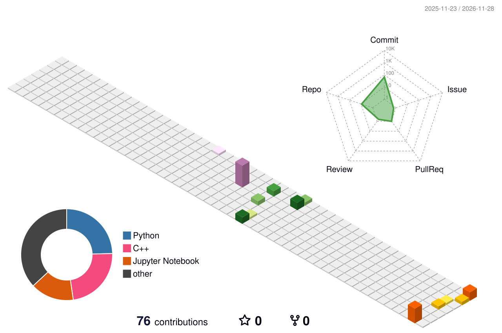

---

### About

I'm a final-year **B.Tech Mechanical Engineering student** at **Tezpur University**, Assam.

Most of my work is on the mechanical side of robots. I model the parts in SolidWorks and check them with FEA. After that I work out the kinematics and control, and test it all in ROS2 and Gazebo. I've also done 3D printing and the usual workshop work.

Currently open to internships and graduate roles in robotics and mechanical design, including automation.

### How I build a robot

### By the numbers

<table align="center">
<tr>
<td align="center"><h2>1 kHz</h2>MRAC control loop</td>
<td align="center"><h2>24</h2>parameters estimated online</td>
<td align="center"><h2>0.13°</h2>best tracking RMSE</td>
<td align="center"><h2>100 mm</h2>quadruped stability margin</td>
<td align="center"><h2>0.12%</h2>FEA vs hand calcs</td>
</tr>
</table>

---

### Projects

| Project | What I did | Tools |
|---|---|---|
| [8-DOF Lower-Limb Exoskeleton](https://github.com/bipashadeka/ROS2-MRAC-Lower-Limb-Exoskeleton) | Built the URDF and a 1 kHz MRAC controller in C++ that estimates 24 dynamic parameters online, with torque and slew-rate limits. Tracking RMSE is 0.13° to 0.74°. | ROS2, C++, URDF, RViz2 |
| [5-DOF Robotic Arm Pick & Place](https://github.com/bipashadeka/ROS2-robo-arm-pick-place) | Designed the arm and a two-finger gripper in SolidWorks, converted it to URDF and used MRAC for a 10-stage pick-and-place in Gazebo. Tracking RMSE of 0.008 to 0.038 rad on the main joints. | ROS2, Gazebo, ros2_control, Python |
| [Quadruped Robot](https://github.com/bipashadeka/quadruped-cad-model-analysis) | Al 6061 body with four 2-DOF legs. Wrote the inverse kinematics and a trot gait in Python (80 mm stride, 0.8 s cycle). Stability margin of 100 mm. | SolidWorks, Python |
| [Industrial Robotic Gripper](https://github.com/bipashadeka/Industrial_Gripper_) | Rack-and-pinion parallel gripper. Did a motion study and a static stress study on it. | SolidWorks Simulation |
| [Robotic Arm Link FEA](https://github.com/bipashadeka/robotic-arm-link-fea-ansys) | Static structural FEA of PLA links. Reactions came within 0.12% of my hand calcs. | ANSYS, Python |
| [IoT Weather Station](https://github.com/bipashadeka/IoT_Weather_Station) | Monitors temperature and humidity in real time. | C++, sensors |

---

### Tools

**CAD & Simulation**

**Robotics & Programming**

---

### Experience

**Industrial Intern, IOCL Guwahati Refinery** (Jun to Jul 2026) 
Studied maintenance of static and rotary equipment like pumps, heat exchangers, furnaces and pressure vessels.

**Industrial Intern, Diesel Loco Shed, NF Railway, Guwahati** (Jun to Jul 2025) 
Worked on ALCO/HHP fuel injection pumps and mechanical unit injectors: inspection, overhauling, calibration and failure analysis.

---

### Activity

<picture>
<source media="(prefers-color-scheme: dark)" srcset="profile-3d-contrib/profile-night-rainbow.svg" />

</picture>

